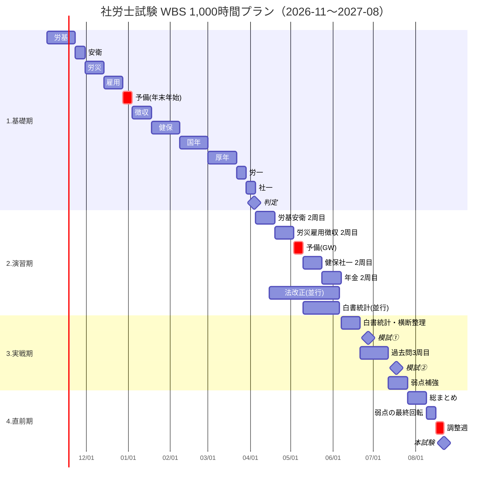

# 社労士試験 WBS（2026-11 〜 2027-08）1,000時間プラン

- 作成日: 2026-10-30（1,000時間プランに組み直し）
- 学習開始: 2026-11-02（月）
- 試験日: **2027-08-22（日）**
- 前提: 初学者・独学（市販テキスト＋過去問題集）
- 計画総量: **約1,000h**
- 判定日: **2027-04-04** に1年合格プランを続けるか、2年計画（2028年8月受験）に切り替えるかを決める（[判定基準](#2027-04-04-の判定基準)）

## 学習時間
| 期間 | 平日 | 休日 | すき間（毎日） | 週合計 | 期間の合計 |
| --- | --- | --- | --- | --- | --- |
| 2026-11-02 〜 2027-04-04（基礎期・22週） | 1.5h | 5h | 30分 | 21h | 約460h |
| 2027-04-05 〜 06-06（演習期・9週） | 2h | 5h | 30分 | 23.5h | 約210h |
| 2027-06-07 〜 08-21（実戦期・直前期・11週） | 2.5h | 7h | 30分 | 30h | 約330h |
| **合計** | | | | | **約1,000h** |

- 累計の目安（ここを下回っていたら黄信号）: 12/27 約175h → 4/04 約460h → 6/06 約670h → 7/25 約880h → 8/21 約1,000h

## 1週間の基本ルーティン
時間は「基礎期 → 演習期 → 実戦期・直前期」の順に記載しています。

| 曜日 | 時間 | 内容 |
| --- | --- | --- |
| 月〜木 | 1.5h → 2h → 2.5h | 基礎期：テキストで新しい範囲を読み、その範囲の一問一答／演習期以降：過去問＋テキストの読み直し |
| 金 | 1.5h → 2h → 2.5h | **予備枠**：遅れの消化。遅れがなければ今週分の復習 |
| 土 | 5h → 5h → 7h | 今週の範囲の過去問演習（択一＋選択）＋間違えた論点を `weak-points` に登録 |
| 日 | 5h → 5h → 7h | 先週以前の範囲の復習（忘却対策）＋最後の1h：**予備・弱点枠** |
| 毎日 | 30分 | すき間時間に一問一答・暗記カード（直近の範囲と `weak-points` の論点） |

- 休養: 金曜は予備日で、遅れがなければ軽めにします。予備週を3回入れています（年末年始・GW・試験前の調整週）。
- 体調が悪い日は無理をせず休み、金曜と日曜の予備枠で取り戻します。遅れが2週間分を超えたら `/weekly` で計画を組み直します。

## WBS
### 1. 基礎期：テキスト1周目＋過去問1周目（2026-11-02 〜 2027-04-04／22週・約460h）
| WBS | タスク | 科目ID | 期間 | 週 | 完了条件 |
| --- | --- | --- | --- | --- | --- |
| 1.1 | 労働基準法 | 01_roki | 11/02–11/22 | 3 | テキスト読了・該当過去問1周 |
| 1.2 | 労働安全衛生法 | 01_roki | 11/23–11/29 | 1 | 同上 |
| 1.3 | 労災保険法 | 02_rosai | 11/30–12/13 | 2 | 同上 |
| 1.4 | 雇用保険法 | 03_koyo | 12/14–12/27 | 2 | 同上 |
| 1.5 | 🔄 予備週（年末年始） | — | 12/28–01/03 | 1 | 遅れの消化・労働科目の総復習（**累計約175h**） |
| 1.6 | 労働保険徴収法 | 02_rosai / 03_koyo | 01/04–01/17 | 2 | 同上＋労災・雇用との関係を整理 |
| 1.7 | 健康保険法 | 06_kenpo | 01/18–02/07 | 3 | 同上 |
| 1.8 | 国民年金法 | 08_kokunen | 02/08–02/28 | 3 | 同上 |
| 1.9 | 厚生年金保険法 | 07_kounen | 03/01–03/21 | 3 | 同上（国年との違いを整理） |
| 1.10 | 労務管理その他の労働に関する一般常識 | 04_roippan | 03/22–03/28 | 1 | 法令部分を読了・過去問1周 |
| 1.11 | 社会保険に関する一般常識 | 05_shaippan | 03/29–04/04 | 1 | 同上 |
| 1.12 | ⚖️ **判定**：1年合格プランを続けるか | — | 04/04 | — | [判定基準](#2027-04-04-の判定基準)で決める |

### 2. 演習期：過去問2周目＋テキスト2周目（2027-04-05 〜 06-06／9週・約210h）
| WBS | タスク | 科目ID | 期間 | 週 | 完了条件 |
| --- | --- | --- | --- | --- | --- |
| 2.1 | 労基・安衛 過去問2周目＋テキスト再読 | 01_roki | 04/05–04/18 | 2 | 択一の正答率70%以上 |
| 2.2 | 労災・雇用・徴収 過去問2周目＋テキスト再読 | 02_rosai / 03_koyo | 04/19–05/02 | 2 | 同上 |
| 2.3 | 🔄 予備週（GW） | — | 05/03–05/09 | 1 | 遅れの消化・弱点の復習 |
| 2.4 | 健保・社一 過去問2周目＋テキスト再読 | 06_kenpo / 05_shaippan | 05/10–05/23 | 2 | 同上 |
| 2.5 | 国年・厚年 過去問2周目＋テキスト再読 | 08_kokunen / 07_kounen | 05/24–06/06 | 2 | 同上（**重点科目**、**累計約670h**） |
| 2.6 | 法改正対策（並行） | 全科目 | 04/中旬–06/06 | — | 法改正の教材を入手し、日曜の予備枠で1周 |
| 2.7 | 白書・統計の読み始め（並行） | 04_roippan / 05_shaippan | 05/10–06/06 | — | 白書・統計の対策本をすき間時間で1周 |
| 2.8 | 選択式の過去問（並行） | 全科目 | 04/05–06/06 | — | 2周目の科目ごとに選択式の過去問5年分 |

### 3. 実戦期：模試・白書統計・過去問3周目（2027-06-07 〜 07-25／7週・約210h）
| WBS | タスク | 科目ID | 期間 | 週 | 完了条件 |
| --- | --- | --- | --- | --- | --- |
| 3.1 | 白書・統計・一般常識の集中対策 | 04_roippan / 05_shaippan | 06/07–06/20 | 2 | 白書・統計の対策本を2周目まで |
| 3.2 | 横断整理（科目をまたいだ比較：待期・時効・届出期限など） | 全科目 | 06/07–06/20 | 2 | 横断の比較表を一通り作成・確認 |
| 3.3 | 📝 公開模試①（6月下旬・予定） | 全科目 | 06/下旬 | — | 受験し `/mock` で記録 |
| 3.4 | 過去問3周目（間違えた問題中心）＋模試①の復習 | 全科目（基準点割れ科目を優先） | 06/21–07/11 | 3 | 模試①で間違えた問題を全部解き直す |
| 3.5 | 📝 公開模試②（7月中旬・予定） | 全科目 | 07/中旬 | — | 受験し `/mock` で記録 |
| 3.6 | 模試②の復習→弱点補強 | 基準点割れ科目 | 07/12–07/25 | 2 | 同上（**累計約880h**） |

### 4. 直前期：総仕上げ（2027-07-26 〜 08-22／4週・約120h）
| WBS | タスク | 科目ID | 期間 | 週 | 完了条件 |
| --- | --- | --- | --- | --- | --- |
| 4.1 | 全科目の総まとめ（数字・横断の暗記） | 全科目 | 07/26–08/08 | 2 | 数字の暗記表を2周 |
| 4.2 | 📝 公開模試③または本試験形式の通し演習（選択80分・択一210分） | 全科目 | 08/01, 08/08 | — | 本番と同じ時間で2回 |
| 4.3 | 弱点リストの最終回転＋法改正・白書の最終確認 | 全科目 | 08/09–08/15 | 1 | 「要復習」をすべて1回以上確認 |
| 4.4 | 🔄 調整週（体調・暗記事項の最終確認） | — | 08/16–08/21 | 1 | 新しい教材には手を出さない（**累計約1,000h**） |
| 4.5 | 🎯 **本試験** | — | 08/22 | — | — |

## 2027-04-04 の判定基準
次の4つのうち3つ以上を満たせば、1年合格プランを続けます。

| # | 基準 | 目安 |
| --- | --- | --- |
| 1 | テキスト1周目の進み具合 | 全科目を読了（遅れは2週間分以内） |
| 2 | 累計学習時間 | 400h以上（計画は約460h） |
| 3 | 過去問1周目の正答率 | 全科目の平均で50%以上 |
| 4 | 生活面 | 仕事や体調に無理がなく、この先さらに時間を増やせそう |

- **続ける場合**: そのまま演習期に入ります。
- **切り替える場合**: 2028年8月受験の2年計画に組み直します（ペースを落とし、2年目に法改正に合わせてテキストを買い直す前提）。**2027年8月の試験は受けます。** 本番の経験になり、選択式は運もあるので合格の可能性も残ります。

## ガントチャート

## 苦手科目の重点化
- 初学者は**年金2科目（国年・厚年）**と**一般常識（労一・社一）**で点を落としやすいため、あらかじめ多めに時間を取っています（年金は各3週＋2周目2週、一般常識は白書・統計を並行して早めに開始）。
- 公開模試①の後、基準点を割った科目を実戦期（3.4・3.6）の重点科目にします。ほかの苦手科目が分かった時点で、日曜の予備・弱点枠をその科目に回します。

## 運用
- 毎日: `/log` で実績を記録し、この WBS のどのタスクを進めたかを照合
- 毎週日曜: `/weekly` で予定と実績・累計時間の目安を比べ、遅れがあれば予備枠に振り替え
- 04/04: 判定基準で継続か切り替えかを決める
- 公開模試の日程が決まったらこのファイルの日付を更新
