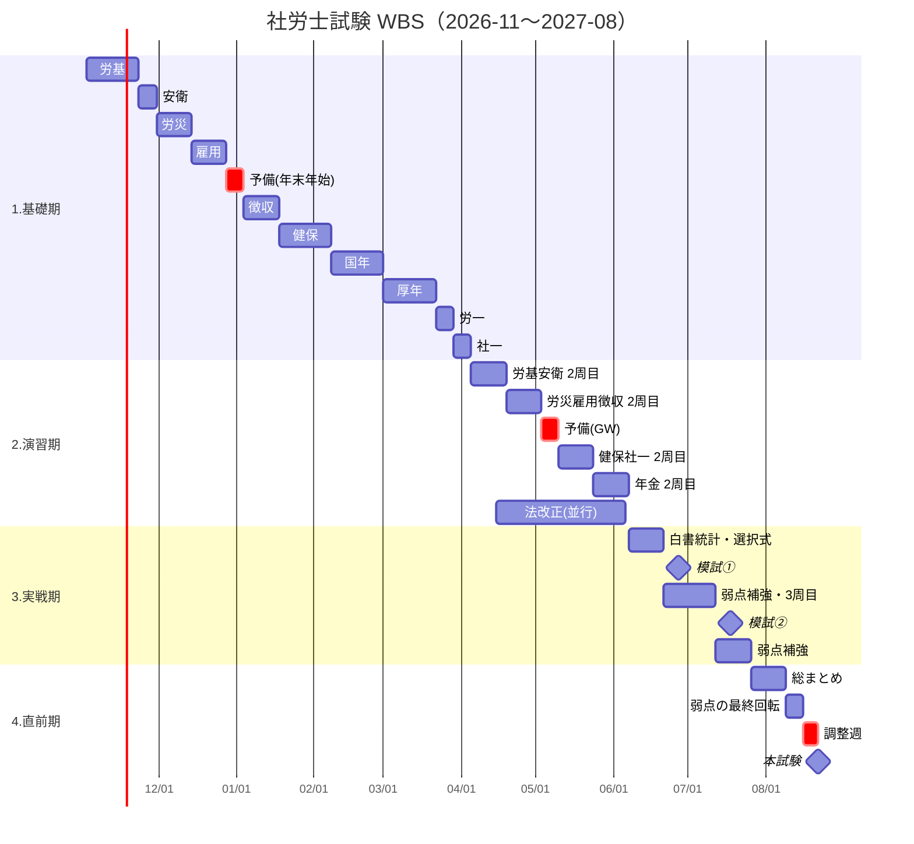

# 社労士試験 WBS（2026-11 〜 2027-08）

- 作成日: 2026-10-30
- 学習開始: 2026-11-02（月）
- 試験日: **2027-08-22（日）**
- 前提: 初学者・独学（市販テキスト＋過去問題集）
- 学習時間: 時期ごとに段階的に増やす（下表）＋毎日すき間時間30分。計画総量 **約740h**

| 期間 | 平日 | 休日 | 週合計 | 期間の合計 |
| --- | --- | --- | --- | --- |
| 2026-11-02 〜 2027-04-04（基礎期） | 1h | 3h | 11h | 約240h |
| 2027-04-05 〜 06-06（演習期） | 1.5h | 4h | 15.5h | 約140h |
| 2027-06-07 〜 08-21（実戦期・直前期） | 2h | 5h | 20h | 約215h |
| 全期間・毎日（すき間時間） | 30分 | 30分 | 3.5h | 約145h |
| **合計** | | | | **約740h** |

> すき間時間（通勤・昼休みなど）は、一問一答アプリや暗記カードで「最近読んだ範囲」と `weak-points` の論点を回します。
> 合格に必要な時間は一般に800〜1,000時間程度と言われるため、余裕がある日は予備枠を前倒しで使って上積みします。

## 1週間の基本ルーティン
時間は「基礎期 → 演習期 → 実戦期・直前期」の順に記載しています。

| 曜日 | 時間 | 内容 |
| --- | --- | --- |
| 月〜木 | 1h → 1.5h → 2h | 基礎期：テキストで新しい範囲を読む／演習期以降：過去問＋テキストの読み直し |
| 金 | 1h → 1.5h → 2h | **予備枠**：遅れの消化。遅れがなければ今週分の復習 |
| 土 | 3h → 4h → 5h | 今週の範囲の過去問演習＋間違えた論点を `weak-points` に登録 |
| 日 | 3h → 4h → 5h | 先週以前の範囲の復習（忘却対策）＋最後の1h：**予備・弱点枠** |
| 毎日 | 30分 | すき間時間に一問一答・暗記カード |

- 休養: 毎週金曜を軽めの予備枠にしているほか、**予備週**を3回入れています（年末年始・GW・試験前の調整週）。
- 遅れが2週間分を超えたら、`/weekly` で計画を組み直します。

## WBS
### 1. 基礎期：テキスト1周目＋過去問（2026-11-02 〜 2027-04-04／22週・約240h）
| WBS | タスク | 科目ID | 期間 | 週 | 完了条件 |
| --- | --- | --- | --- | --- | --- |
| 1.1 | 労働基準法 | 01_roki | 11/02–11/22 | 3 | テキスト読了・該当過去問1周 |
| 1.2 | 労働安全衛生法 | 01_roki | 11/23–11/29 | 1 | 同上 |
| 1.3 | 労災保険法 | 02_rosai | 11/30–12/13 | 2 | 同上 |
| 1.4 | 雇用保険法 | 03_koyo | 12/14–12/27 | 2 | 同上 |
| 1.5 | 🔄 予備週（年末年始） | — | 12/28–01/03 | 1 | 遅れの消化・労働科目の総復習 |
| 1.6 | 労働保険徴収法 | 02_rosai / 03_koyo | 01/04–01/17 | 2 | 同上 |
| 1.7 | 健康保険法 | 06_kenpo | 01/18–02/07 | 3 | 同上 |
| 1.8 | 国民年金法 | 08_kokunen | 02/08–02/28 | 3 | 同上 |
| 1.9 | 厚生年金保険法 | 07_kounen | 03/01–03/21 | 3 | 同上（国年との違いを整理） |
| 1.10 | 労務管理その他の労働に関する一般常識 | 04_roippan | 03/22–03/28 | 1 | 法令部分を読了 |
| 1.11 | 社会保険に関する一般常識 | 05_shaippan | 03/29–04/04 | 1 | 法令部分を読了 |

### 2. 演習期：過去問2周目＋テキスト2周目（2027-04-05 〜 06-06／9週・約140h）
| WBS | タスク | 科目ID | 期間 | 週 | 完了条件 |
| --- | --- | --- | --- | --- | --- |
| 2.1 | 労基・安衛 過去問2周目 | 01_roki | 04/05–04/18 | 2 | 正答率70%以上 |
| 2.2 | 労災・雇用・徴収 過去問2周目 | 02_rosai / 03_koyo | 04/19–05/02 | 2 | 正答率70%以上 |
| 2.3 | 🔄 予備週（GW） | — | 05/03–05/09 | 1 | 遅れの消化・弱点の復習 |
| 2.4 | 健保・社一 過去問2周目 | 06_kenpo / 05_shaippan | 05/10–05/23 | 2 | 正答率70%以上 |
| 2.5 | 国年・厚年 過去問2周目 | 08_kokunen / 07_kounen | 05/24–06/06 | 2 | 正答率70%以上（**重点科目**） |
| 2.6 | 法改正対策（並行） | 全科目 | 04/中旬–06/06 | — | 法改正の教材を入手し日曜の予備枠で1周 |
| 2.7 | 白書・統計の読み始め（並行） | 04_roippan / 05_shaippan | 05/10–06/06 | — | 白書・統計の対策本をすき間時間で1周 |

### 3. 実戦期：模試・白書統計・弱点補強（2027-06-07 〜 07-25／7週・約140h）
| WBS | タスク | 科目ID | 期間 | 週 | 完了条件 |
| --- | --- | --- | --- | --- | --- |
| 3.1 | 白書・統計・一般常識の集中対策 | 04_roippan / 05_shaippan | 06/07–06/20 | 2 | 白書・統計の対策本を2周目まで |
| 3.2 | 選択式対策（条文の穴埋め） | 全科目 | 06/07–06/20 | 2 | 選択式の過去問5年分 |
| 3.3 | 📝 公開模試①（6月下旬・予定） | 全科目 | 06/下旬 | — | 受験・`/mock` で記録 |
| 3.4 | 模試①の復習→弱点補強・過去問3周目 | 基準点を割った科目 | 〜07/中旬 | 3 | 間違えた問題をすべて解き直す |
| 3.5 | 📝 公開模試②（7月中旬・予定） | 全科目 | 07/中旬 | — | 受験・`/mock` で記録 |
| 3.6 | 模試②の復習→弱点補強 | 基準点を割った科目 | 〜07/25 | 2 | 同上 |

### 4. 直前期：総仕上げ（2027-07-26 〜 08-22／4週・約75h）
| WBS | タスク | 科目ID | 期間 | 週 | 完了条件 |
| --- | --- | --- | --- | --- | --- |
| 4.1 | 全科目の総まとめ（数字・横断整理） | 全科目 | 07/26–08/08 | 2 | 数字の暗記表を一通り確認 |
| 4.2 | 本試験形式の時間配分演習（選択80分・択一210分） | 全科目 | 08/01, 08/08 | — | 本番と同じ時間で通し演習を2回 |
| 4.3 | 弱点リストの最終回転 | 全科目 | 08/09–08/15 | 1 | 「要復習」をすべて1回以上確認 |
| 4.4 | 🔄 調整週（体調・暗記事項の最終確認） | — | 08/16–08/21 | 1 | 新しい教材には手を出さない |
| 4.5 | 🎯 **本試験** | — | 08/22 | — | — |

## ガントチャート

## 苦手科目の重点化
- 初学者は**年金2科目（国年・厚年）**と**一般常識（労一・社一）**で点を落としやすいため、あらかじめ多めに時間を取っています（年金は各3週＋2周目2週）。
- 公開模試①の後、基準点を割った科目を実戦期（3.4／3.6）の重点科目にします。そのほかの苦手科目が分かった時点で、日曜の予備・弱点枠をその科目に回します。

## 運用
- 毎日: `/log` で実績を記録 → この WBS のどのタスクを進めたかを Claude が照合
- 毎週日曜: `/weekly` で予定と実績を比べ、遅れがあれば予備枠に振り替え
- 公開模試の日程が決まったらこのファイルの日付を更新
- 4/05・6/07 の時間の切り替え日に、無理なく続けられそうか `/weekly` で確認
